# NIFLIX — Tienda en línea (Ecommerce App)

Frontend de ecommerce construido con React + Vite + Tailwind. Catálogo, búsqueda en vivo, filtros, carrito persistente y checkout simulado en 4 pasos. Datos de `dummyjson.com`.

**Demo en vivo:** https://wilkinmotauribel98-blip.github.io/ecommerce-app
**Repositorio:** https://github.com/wilkinmotauribel98-blip/ecommerce-app

> Proyecto de portafolio. Sin backend real, autenticación ni pagos — el checkout es simulado.

## Capturas

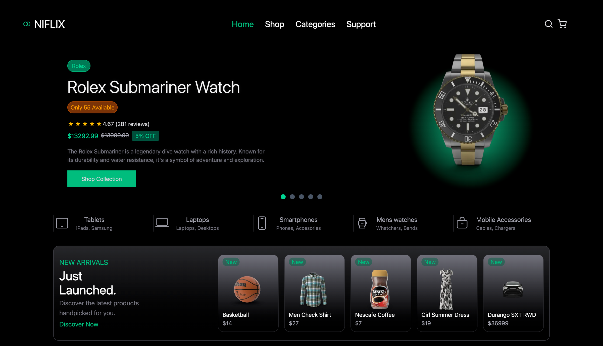
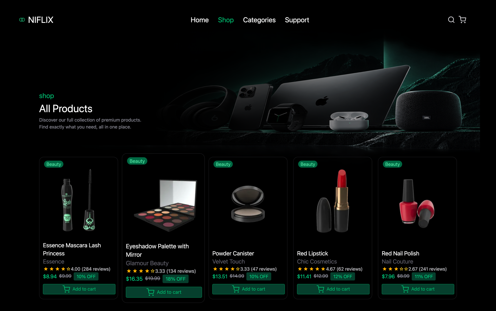
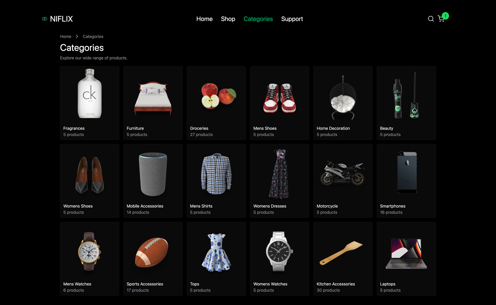
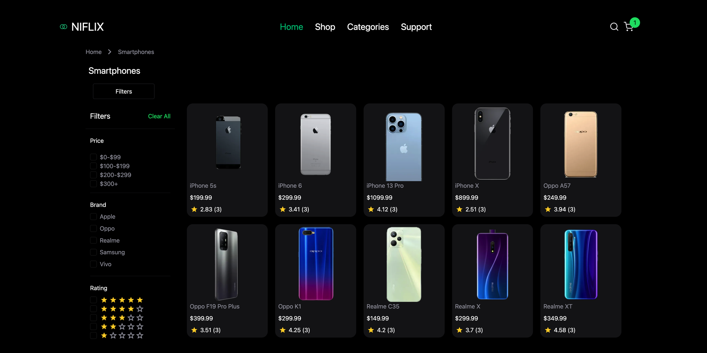
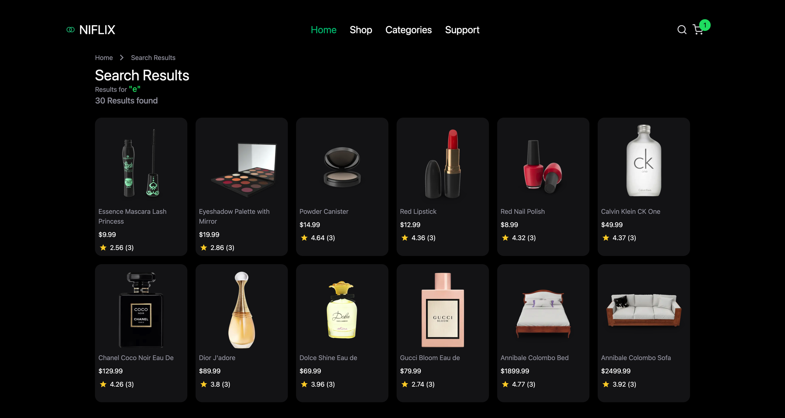
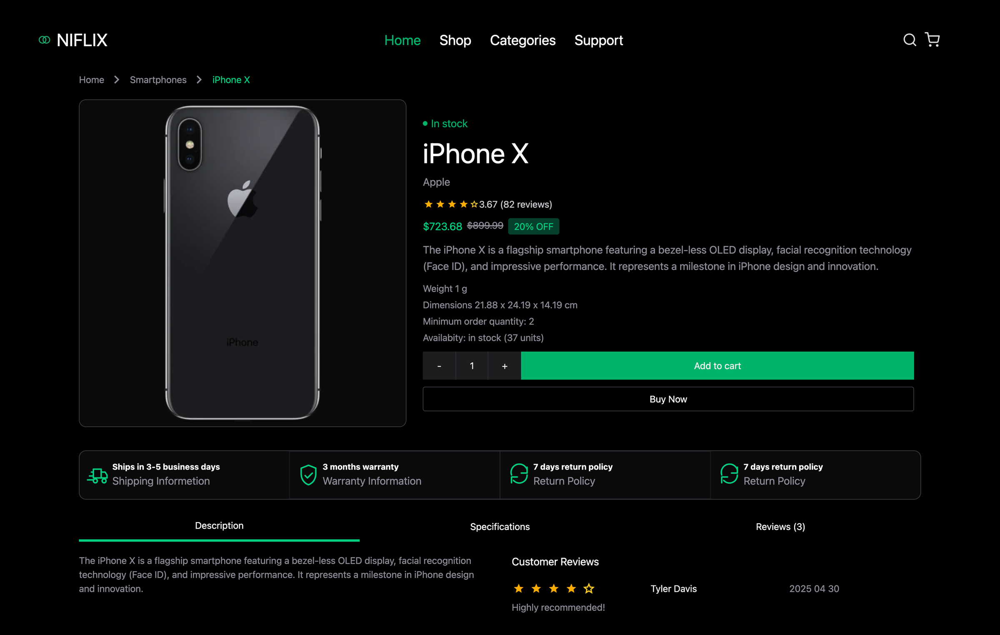
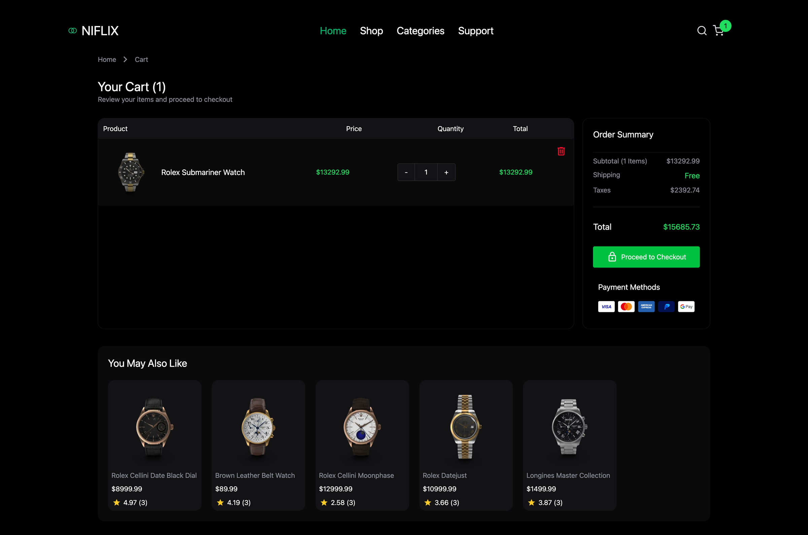
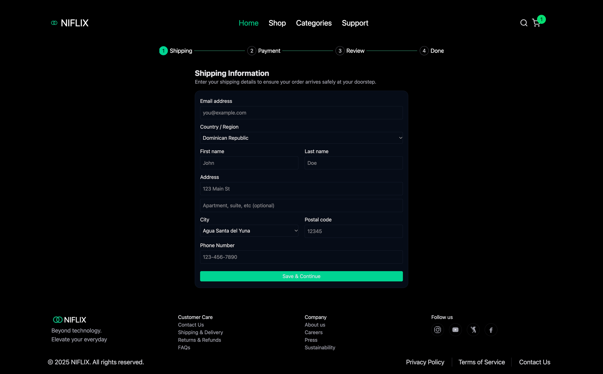
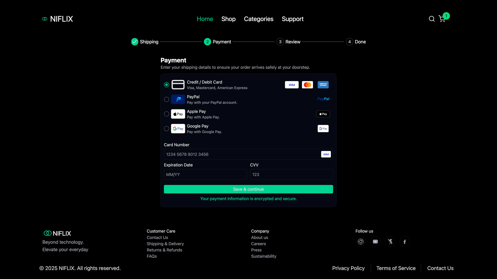
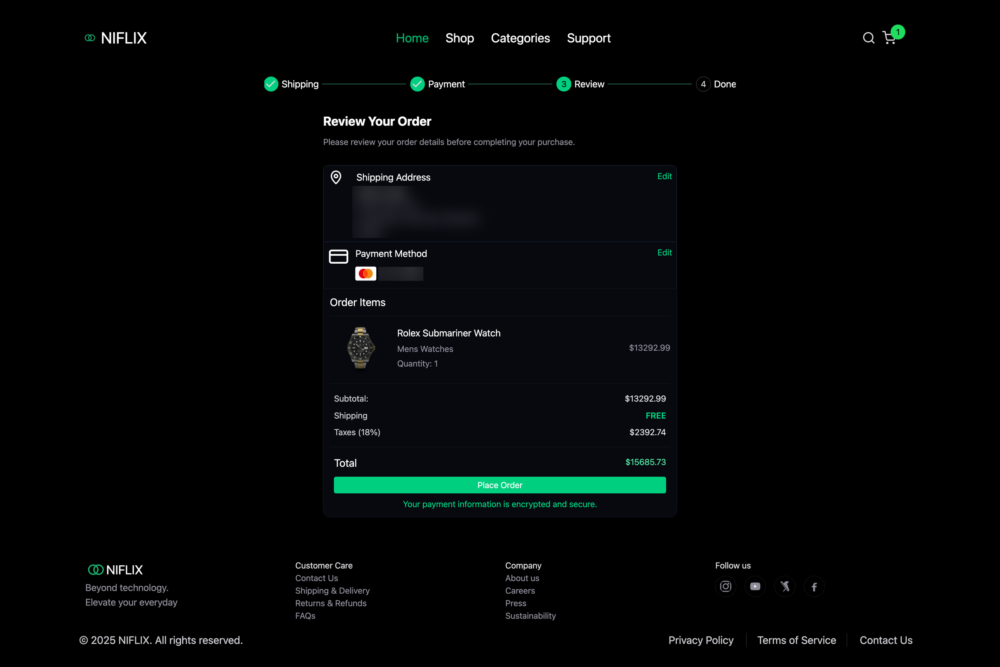
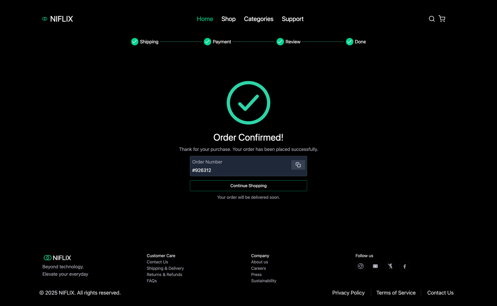
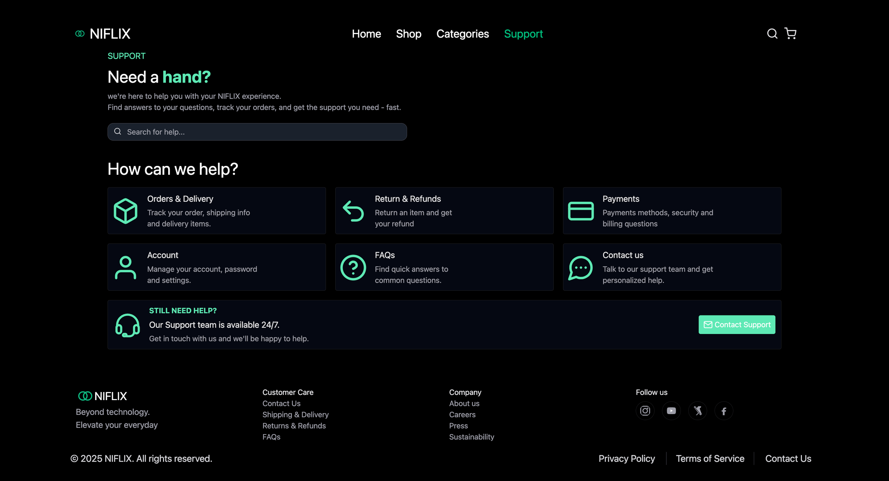

## Tecnologías

- React 18.3, React Router 6.26, Vite 5.4
- Tailwind CSS 4.3 + @tailwindcss/vite
- zustand 4.5 (solo el carrito persiste en `localStorage` como `client-storage`)
- react-hook-form 7.86, libphonenumber-js (validación de teléfono DO)
- Imágenes optimizadas con `wsrv.nl` (helper centralizado `optimizedImg`)

## Funcionalidades

- Inicio: carrusel hero, accesos a categorías, novedades, más vendidos, newsletter
- Tienda `/ecommerce-app/shop` con paginación; página de Categorías con conteo de productos
- Detalle de categoría con filtros de precio/marca/calificación y botón `Clear All`
- Detalle de producto: descuento, stock, peso, dimensiones, pedido mínimo, cantidad, `Add to cart` y `Buy Now`, garantías, pestañas (Descripción/Especificaciones/Reseñas) y recomendaciones
- Búsqueda en vivo con sugerencias (`/ecommerce-app/results/search?q=`); sin historial de búsquedas persistido
- Carrito: agregar / cantidad / eliminar, drawer + página, impuesto del 18% (`TAX_RATE`), persistido en `localStorage`, productos relacionados
- Checkout con rutas anidadas: `shipping → payment → review → done`, formularios validados con react-hook-form, detección del tipo de tarjeta en vivo, número de pedido con botón para copiar
- Responsive: Header de escritorio + BottomNavbar móvil, skeletons, rutas lazy con `Suspense`
- Página de Soporte con buscador de ayuda, 6 temas y contacto 24/7

## Inicio rápido

```bash
npm install
npm run dev      # http://localhost:5173/ecommerce-app
npm run build
npm run preview
```

No se necesita `.env`. La URL de la API está fija en `https://dummyjson.com` dentro de `src/api/products.js`.

## Arquitectura

```text
src/
  App.jsx            # rutas + páginas lazy, base /ecommerce-app
  main.jsx           # BrowserRouter + StrictMode
  api/products.js    # fetchProduct, fetchCategories, searchProducts
  hooks/
    useFetch.js      # fetch genérico + AbortController
    useProducts.js   # productos del home (caché en memoria de 1 h, sin persistencia)
    useCart.js       # carrito {id -> producto}, impuesto 0.18 (TAX_RATE, persist: client-storage)
    useCheckout.js   # datos de envío + pago del checkout (sin persistencia)
  context/
    PageContext.jsx  # página actual según la ubicación
  pages/             # Home, Shop, Category, Categories, Product, Results, Cart, Checkout, Support, NotFound
  components/
    cart/ checkout/ product/ category/ shop/ results/ support/
    layout/header + bottomNavbar + footer/
    ui/              # Button, Badge, Skeleton, Suggestions, AddToCart, etc.
                     # (sin componentes Icon/Sprite: los iconos son <svg><use> en línea
                     #  con publicUrl() + sprites en public/: sprite-core/extra, payment-icons)
  sections/          # Hero, BestSellers, NewArrivals, TrustBar, Newsletter, etc.
  utils/
    loading.js             # preloadImages, minDelay
    optimizedImg.js        # URLs optimizadas vía wsrv.nl
    publicUrl.js           # URLs públicas con import.meta.env.BASE_URL
    location.js            # países (Intl) + ciudades RD sin dependencias pesadas
    getCardType.js         # detección de marca (visa, mastercard, amex…)
    detectCardTypeLive.js  # detección en vivo mientras se escribe
```

Rutas: todas empiezan con `/ecommerce-app` (`vite.config.js: base`). El checkout usa `<Outlet/>` anidado con redirección al paso `shipping`.

Estado: zustand + persist, sin Redux. Formularios con react-hook-form.

## Qué haría en producción

1. Backend real + Stripe (nunca guardar datos de tarjeta — hoy el checkout es solo demo)
2. Autenticación, pedidos, cupones, wishlist, panel admin
3. Endurecer guards entre pasos del checkout y ampliar la cobertura de `ErrorBoundary` y estados vacíos/de error
4. `eslint + prettier + vitest + Playwright`, `.env` para la URL de la API, eliminar código muerto
5. SSR/prerender + JSON-LD, robots/sitemap, i18n
6. Dividir el bundle principal (hoy supera los 500 kB que advierte Vite)

## Limitaciones conocidas

- Datos públicos de `dummyjson.com`, total `194` fijo en `RenderAllProducts.jsx`
- Sin tests ni linter; interfaz en inglés
- Imágenes con `loading="lazy"` (y `eager` + `fetchPriority="high"` en hero/producto principal)
